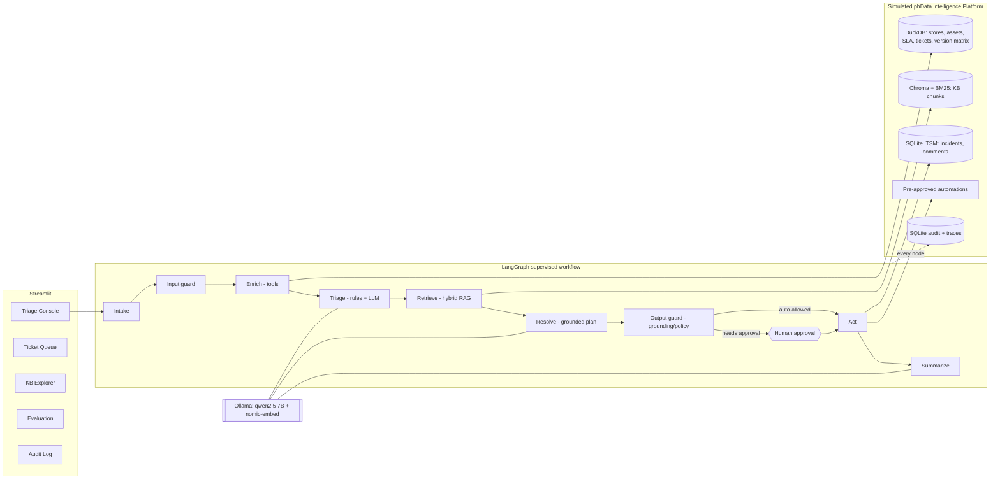

# ServeWell IT Support Agent — Implementation Plan

Goal: a **working Streamlit prototype** of an agentic L1 triage system that ingests an incident,
enriches it from structured data, grounds itself in the KB, walks toward a resolution (guided
steps or a simulated action), escalates safely, and leaves a full audit trail. It must also accept
**fresh, unseen tickets** (the panel will supply test cases), so it runs on 100% open-source,
local components.

---

## 1. What the data tells us (findings that shape the design)

| Finding | Evidence | Design consequence |
| --- | --- | --- |
| Index paths are wrong | `train_index.csv` says `raw/INC-*.json`; files live in `tickets/train/`; `raw/` is absent | Loader resolves `raw/`, `train/` and a plain filename, so a test drop in any layout works (done in `load_dataset.py`) |
| 36 of 256 tickets are unlabelled "chaos" tickets | `chaos_type`: vague 6, misdirection 5, miscategorized 5, emotional 5, false_asset 4, contradictory 4, red_herring 4, unknown_system 3 | The unseen test set will probe robustness. Each chaos type needs an explicit handling path and a test (see §5) |
| Train labels contain only 2 of the 5 routing classes | 143 `l2_escalation`, 77 `l1_guided`; `l1_self_service`, `non_it`, `needs_clarification` never appear | Those three classes can't be learned from labels. They are handled zero-shot through **rules + LLM + guardrails**, not a trained classifier |
| Escalation is driven by ticket history | Escalation reasons repeat "L1 has exhausted troubleshooting…"; 149 tickets have `ticket_history` | Enrichment summarises prior L1 steps. A deterministic rule ("runbook steps already tried and failed") feeds the escalation decision |
| `asset_id` and `category` can be wrong or contradictory | INC-00005: Kiosk "payment reader" ticket, router asset, actually about a personal card and payroll | Validate the asset against the store and the category; flag mismatches; detect non-IT/HR intent |
| Labels hold retrieval ground truth | `relevant_kb_docs`: runbooks 510, specs 219, FAQ 181, SOP 99 | Measure retrieval recall@k **before** adding any LLM, so retrieval tuning is evidence-based |
| Labels hold a behaviour rubric | `chaos_correct_behavior` PASS/FAIL text, `correct_resolution_summary` | LLM-as-judge evaluation against the rubric, plus exact-match metrics for routing and escalation |
| Known bugs are tabulated | `system-specs/version-matrix.csv` (known_bugs, patch_available, EOL) | Enrichment step: "your version has a known bug, patch X" is a strong, grounded quick win |
| SLA is by priority and identical across categories | `sla_matrix.csv` | SLA clock computed from `date_opened` → first-response and L2-escalation deadlines |
| The KB is small | ~50 docs, ~76k words | Local embeddings plus Chroma are ample. Hybrid BM25 fixes exact-token misses (error codes like `ERR-4521`, model numbers) |

**Pilot slice** (per the challenge's "start small"): tune and demo deeply on **POS + Printers**
(99 train tickets, the brief's own examples: "POS offline", "receipt printer not working").
The pipeline is category-agnostic, so the other categories still run end-to-end but are evaluated
with less tuning, and the plan says so openly.

---

## 2. Architecture

### Agents and responsibilities

The workflow is a **supervised, deterministic LangGraph graph with specialised nodes**, not free-form
multi-agent chat. That makes it auditable, reproducible and easy to explain.

| Node / "agent" | Responsibility | Tool or LLM? |
| --- | --- | --- |
| Intake | Normalise JSON, form or free text into the `Ticket` schema | Code |
| Input guard | Mask PII, detect prompt injection, flag non-IT/HR/payroll intent and emotional tone | Rules (+ LLM for intent) |
| Enrich | Look up store, asset (validated), SLA clock, version-matrix bugs, history and related tickets | **Tools only**, no LLM (facts) |
| Triage | Correct the category and decide routing (5 classes), confidence and rationale | **SOP rules first, then LLM**, then merged |
| Retrieve | Build the query from ticket + enrichment; run hybrid search filtered by category/system | Tool |
| Resolve | Produce guided steps citing chunk IDs, **or** an L2 escalation package per `escalation-procedure.md`; propose next-best actions | LLM (JSON schema output) |
| Output guard | Check citations/grounding, invented codes/versions and the autonomy policy; low confidence → escalate or clarify | Rules + LLM check |
| Act | Execute approved actions on the simulated ITSM and automations | Tool |
| Summarize | Plain-language reply to the store manager plus a structured ticket work note | LLM |

**Tools vs reasoning:** anything factual (asset, SLA, history, known bugs) is a deterministic tool
call and always runs. The LLM is used only where it adds value: reading messy human text,
choosing among runbook paths, and writing. This removes a whole class of hallucination.

### Retrieval (RAG) design

- **Chunking:** split markdown by H2/H3 headings (runbook sections like "Immediate Steps" and
  "L1 Diagnosis" are natural units). Cap at ~350 words, with a doc title and section path prefixed.
- **Metadata:** `doc_path`, `doc_type` (runbook/faq/sop/spec), `category`, `systems[]`, `section`.
- **Hybrid search:** BM25 plus dense (nomic-embed), fused with Reciprocal Rank Fusion, with a soft
  category filter (widened if the ticket may be miscategorised). The version matrix is queried
  as structured data, not embedded.
- **Grounding contract:** the Resolve prompt gets numbered chunks and must cite `[C3]` on every
  step. The output guard rejects steps with no citation or with citations outside the retrieved set.

### Autonomy line (human-in-the-loop)

| Action | POC behaviour |
| --- | --- |
| Read-only lookups, retrieval | Auto |
| Post internal work note / enrichment comment | Auto (audited) |
| Set routing + assign queue | Auto if confidence ≥ threshold **and** no guardrail flags; otherwise human approval |
| Send guided steps to the requester | Auto for `l1_guided`/`l1_self_service` when grounded |
| Pre-approved automation (e.g. restart POS service, reset router port) | **Human approval** (LangGraph `interrupt`) |
| Escalate to L2 / P1 on-call notification | Auto-drafted package; human confirms |
| Anything not on the allow-list | Blocked, logged |

---

## 3. Tech stack & trade-offs (to defend in the panel)

| Decision | Choice | Why / trade-off |
| --- | --- | --- |
| UI | Streamlit | Fastest path to an interactive demo in Python; not a production UI |
| Orchestration | LangGraph | Explicit state machine, native HITL `interrupt`, checkpointing, easy to trace. Alternatives: CrewAI (less control), plain code (no HITL/checkpoint for free) |
| LLM | `qwen2.5:7b-instruct` on Ollama | Apache-2.0, local (no data leaves the machine), free, good JSON/tool following, fits 16 GB on the M4. Trade-off: weaker than frontier models and ~20–40 s per ticket. The model sits behind a LangChain chat interface, so moving to Snowflake Cortex or a hosted model is a config change |
| Embeddings | `nomic-embed-text` via Ollama | One runtime, no PyTorch dependency, strong retrieval quality |
| Vector store | Chroma + BM25 | Persistent, zero-ops, fine for a ~50-doc KB. Production: the platform's vector service (e.g. Cortex Search) |
| Structured data | DuckDB | SQL over CSV/JSON, stands in for Snowflake tables |
| Observability | SQLite audit + in-app trace viewer | Zero infrastructure. Production: Langfuse (MIT, self-host) or OpenTelemetry |
| Determinism | temperature 0, JSON schema output, prompt versions logged | Reproducible evals and explainable decisions |

---

## 4. Implementation phases

Each phase ends in something runnable in Streamlit.

### Phase 0 — Environment ✅ (done)
- uv + Python 3.12, `.venv` with all dependencies, Ollama 0.34 CLI, models pulled.
- Folder skeleton, config, dataset loader with the path fix, Home page health check.
- **Exit:** `uv run streamlit run app/Home.py` shows all health checks green (except "KB index").

### Phase 1 — Data layer and schemas
- `models/schemas.py`: Pydantic `Ticket`, `Label`, `EnrichedContext`, `TriageDecision`,
  `KBCitation`, `ProposedAction`, `AgentResult`.
- `platform/data_access.py`: DuckDB views; `get_store`, `get_asset` (plus a store/category
  consistency check), `get_sla(priority, category, opened_at)` → deadlines,
  `known_issues(system_version)`, `ticket_history_summary`, `similar_tickets` (same store/asset/category).
- `tests/test_data_access.py`.
- **Exit:** enrichment for any train ticket returns a complete, validated context object.

### Phase 2 — KB ingest and hybrid retrieval
- `ingest/chunk_kb.py`, `ingest/build_index.py`, `scripts/build_index.py`.
- `platform/retrieval.py`: BM25 + Chroma + RRF, metadata filters, scores.
- **KB Explorer page:** browse docs, type a query, see ranked chunks and scores.
- **Measure:** doc-level recall@6 against `relevant_kb_docs` on the 220 labelled tickets.
  Target ≥ 0.80 on the POS/Printer slice. Tune chunking, fusion and query construction here.
- **Exit:** retrieval metric printed and shown on the page.

### Phase 3 — Agent graph and Triage Console (end-to-end happy path)
- `agents/llm.py` (Ollama with JSON-schema `format`, retries, latency and token capture).
- `agents/state.py`, `agents/graph.py`, nodes: intake, enrich, triage, retrieve, resolve, summarize.
- Prompts versioned in `agents/prompts/*.md`.
- **Triage Console page:** pick a train ticket **or** paste/upload a new one → run → stream
  node-by-node progress → show enrichment, routing + confidence + rationale, cited steps, the
  requester message and the ticket work note.
- **Exit:** INC-00162 (printer driver) produces cited guided steps; an L1-exhausted POS ticket
  produces an L2 escalation package.

### Phase 4 — Guardrails, HITL, actions, audit
- `guardrails/input_checks.py`, `guardrails/grounding.py`, `guardrails/policy.py`.
- `platform/itsm.py` (SQLite incidents, comments, status, queue) and `platform/automations.py`
  (allow-listed mock automations).
- LangGraph `interrupt` before sensitive actions. Approve/Reject buttons in the console.
- `observability/audit.py`: every node's input, output, latency, model and prompt version, plus
  every action.
- **Ticket Queue** and **Audit Log** pages.
- **Exit:** a low-confidence or ungrounded run is visibly blocked or escalated; an approved
  automation appears in the ITSM queue and in the audit log.

### Phase 5 — Evaluation harness
- `evaluation/metrics.py`: routing accuracy and macro-F1, escalation precision/recall (optimise
  **recall** on escalations, since a missed escalation costs more than an unnecessary one),
  KB recall@k, grounding rate, guardrail trigger rate, p50/p95 latency.
- `evaluation/judge.py`: LLM judge against `correct_resolution_summary` and the
  `chaos_correct_behavior` PASS/FAIL rubric.
- `scripts/run_eval.py` plus the **Evaluation page** (confusion matrix, per-category table,
  drill-down into failures).
- Hold out ~20% of labelled tickets as a dev-test split so prompt tuning doesn't overfit.
- **Exit:** metrics report and a list of known failure modes.

### Phase 6 — Fresh-data intake and demo readiness
- Intake from: (a) a single JSON upload, (b) a folder or multi-file upload for batch, (c) a CSV
  index like `train_index.csv`, (d) a free-text "store manager" form with missing fields left blank
  (which exercises the `needs_clarification` path).
- `samples/new_tickets/`: 5–6 hand-written unseen tickets, one per chaos type, for the live demo.
- **Architecture page:** the diagram and trade-off table for the walkthrough.
  `docs/demo_script.md`: a 10-minute narrated flow for the business VP and Director of Technology.
- **Exit:** a batch of new tickets runs without code changes; README lets a stranger run it.

### Phase 7 — Hardening
- Fallbacks: if Ollama is down, fall back to BM25-only retrieval and a rules-only triage with an
  "LLM unavailable → human review" banner.
- Latency: cache enrichment and retrieval, cap tokens, add an optional smaller model for triage.
- Run all 36 chaos tickets; record behaviour per type.

---

## 5. Chaos-type handling (the unseen-data test)

| Chaos type | Expected behaviour | Mechanism |
| --- | --- | --- |
| vague | `needs_clarification` with specific questions (asset, error text, since when) | Missing-field check plus LLM info-sufficiency score |
| misdirection / non-IT | `non_it`: politely redirect (HR/payroll/facilities); take no IT action | Intent classifier in the input guard |
| miscategorized | Correct the category, retrieve from the right domain | Triage re-classifies; retrieval filter widened |
| emotional | Calm, empathetic tone; judge by facts, not urgency words | Tone flag; priority is based on impact rules, not wording |
| false_asset | Flag the asset/store/category mismatch; ask to confirm | Asset validation in Enrich |
| contradictory | Surface the contradiction; ask the user or escalate | LLM consistency check → `needs_clarification` |
| red_herring | Ignore irrelevant details; root cause comes from symptoms | Grounding in runbook symptoms |
| unknown_system | Say "not in our KB/version matrix" → escalate; **never invent** steps | Low retrieval score plus unknown version → escalate |

---

## 6. Success criteria for the prototype

- An end-to-end run on any ticket in ≤ ~45 s locally, with a full, readable trace.
- Routing accuracy on the labelled dev-test split reported honestly, with a per-category breakdown.
- 100% of guided steps cite a retrieved chunk (grounding check enforced).
- Every action is audited; sensitive actions need explicit approval.
- New tickets (JSON, batch or free text) run with no code change.

## 7. Known limitations (to state candidly)

- A 7B local model reasons less well than frontier models; latency is seconds, not milliseconds.
- There are no labels for 3 of the 5 routing classes, so those paths are validated with hand-made
  cases, not statistics.
- Automations and ITSM are simulated. Telemetry is absent from the dataset, so it isn't modelled.
- LLM-as-judge is itself imperfect; spot-check it by hand.
